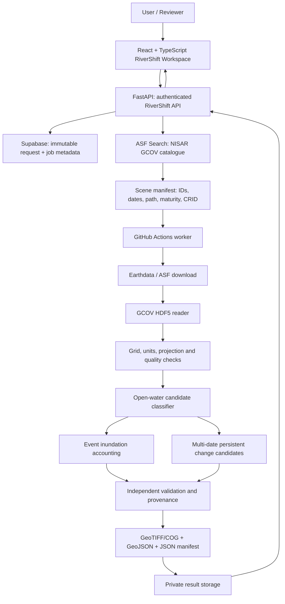

# RiverShift — System Architecture

**Product:** RiverShift — Flood & River Change Intelligence  
**Parent application:** SARGuardian Dynamic  
**NASA Space Apps 2026 challenge:** Dancing with the SARs  
**Challenge category:** Earth Science / Earth's surface

## 1. Product intent

RiverShift uses repeat-pass NISAR radar observations to help users inspect and quantify changes in river systems. The first study will be a controlled reach of the Jamuna River near Sirajganj, subject to a successful NISAR catalogue coverage audit.

The first release separates two phenomena:

- **Event inundation:** temporary expansion of water coverage during a flood.
- **Persistent river morphology candidates:** land-to-water and water-to-land transitions that remain after water levels recede.

This separation prevents a peak-stage river expansion from being mislabeled as permanent channel migration.

## 2. Logical architecture

## 3. Existing infrastructure reuse

| Existing SARGuardian component | RiverShift use | Rule |
|---|---|---|
| React/Vite frontend | New RiverShift route and workspace | Do not change Landslide UI behavior |
| Firebase Authentication | User identity | Reuse existing ID-token verification |
| FastAPI | RiverShift endpoints | Add a separate router/module |
| Supabase | Durable RiverShift job metadata | New migration; no alteration to Landslide table meaning |
| GitHub Actions | GCOV worker | New workflow, isolated concurrency group |
| Private Google Drive result retention | Large result packages | Keep existing owner-scoped access controls |
| Vercel | Frontend, existing supported deployment arrangement | Do not add secrets to browser variables |
| Render | Existing API service where configured | Reuse existing server-side variables |

## 4. Scientific processing architecture

### 4.1 Data discovery

Use ASF `asf_search` with `dataset="NISAR"`, `processingLevel="GCOV"`, explicit date window, AOI and an explicit `dataMaturity`. Discovery is metadata-only.

A stack manifest must retain:
- Granule name and product ID.
- Observation start/stop times.
- Flight direction, path/frame where available.
- Frequency, polarizations and product maturity.
- CRID / processing baseline where available.
- Product URL and source file size where available.
- AOI WKT hash and request parameters.

### 4.2 Product reading

Read the documented GCOV HDF5 diagonal covariance term (e.g. `VVVV`) and same-grid x/y coordinate arrays and projection metadata. Do not guess UTM zone, resolution or geotransform. Reject incompatible grids or unsupported layers.

### 4.3 Water classification

Convert positive linear gamma-naught power to dB and produce open-water candidates using a declared Otsu or fixed threshold. Keep the selected threshold, valid-pixel mask and all provenance.

This baseline is intentionally not advertised as a full flooded-vegetation classifier. It needs local reference calibration and future contextual features.

### 4.4 Inundation

`newly_inundated = event_water AND NOT baseline_water`

The baseline should be a stable or persistent water reference where possible. Report baseline water, event water and newly inundated area separately.

### 4.5 Persistent morphology candidates

Use one pre-event reference and at least two comparable post-recession observations. A candidate must persist across the declared fraction of valid post-event observations.

- Pre-event land + persistent post-event water = erosion candidate.
- Pre-event water + persistent post-event land = deposition candidate.

These are candidate transitions until independently checked.

## 5. Deployment boundary

Canonical science code belongs in `Backend/science_adapter/river_shift/`, so the existing Backend deployment root can import it. Worker-facing scripts belong in `tools/river_shift/`. The independent package dependencies are listed in `Backend/requirements-river-shift.txt`.

The initial foundation does not yet add API routes, Supabase schema, download worker, result upload or frontend route. Those are subsequent integration tasks and must be separately reviewed before deployment.

## 6. Failure and safety controls

- No result without a source-product manifest.
- No mixing of BETA and PROVISIONAL processing maturity within one comparison stack.
- Reject unsupported covariance terms and missing coordinate metadata.
- Do not treat no-data as dry land.
- Require same-grid alignment before pixel-wise subtraction.
- Record all algorithm settings and validity rules.
- Never expose Earthdata, GitHub, Firebase Admin or Supabase server secrets to the browser.
- Mark results as candidate / provisional until validation is complete.
- UI must not present a candidate map as a public flood warning.

## 7. Next engineering increments

1. GCOV catalogue endpoint and Jamuna coverage audit.
2. GCOV download worker and checksum/source manifest.
3. COG/GeoJSON export clipped to the AOI.
4. Comparable-scene stack validator (track, frame, maturity, CRID, frequency, polarization).
5. Event inundation and persistent morphology batch runner.
6. Bankline extraction and transect displacement.
7. Independent reference-validation package.
8. Supabase jobs + GitHub Actions dispatch + private result retrieval.
9. RiverShift interactive workspace.
10. Final NASA challenge narrative and public project-page evidence.
